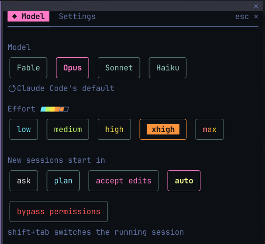
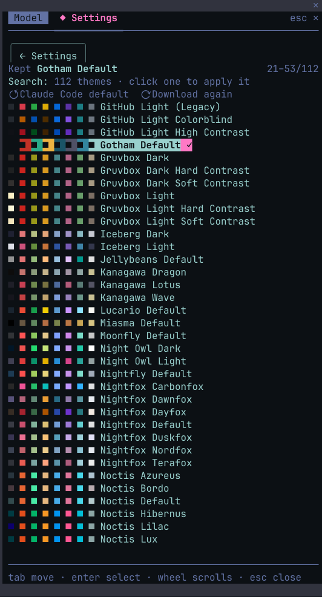
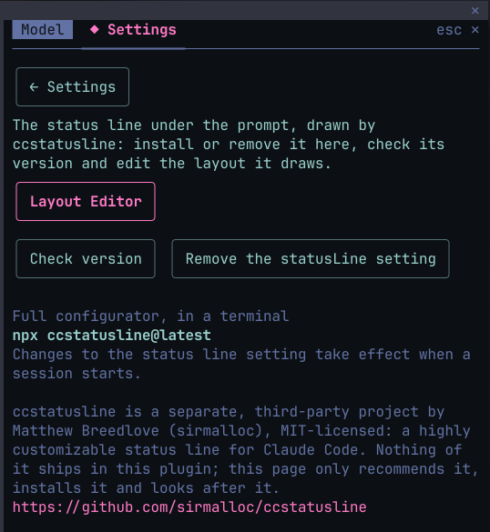
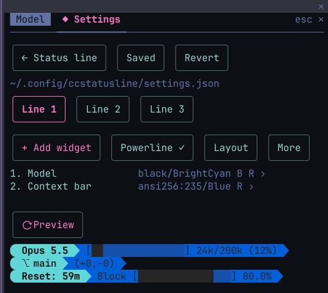
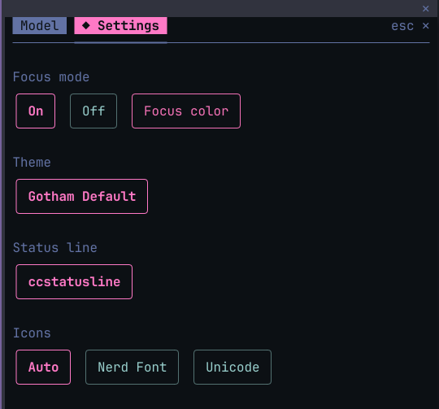

# cc-focusdeck

**A deck for Claude Code: a Focus band with the task's progress, model and effort controls, terminal themes, and a status line editor.**

cc-focusdeck adds a pane to [Claude Code](https://claude.com/claude-code) and a band above the prompt. It started as the part of [cc-esol](https://github.com/rapha-rodrigues/cc-esol) that was not the English coach; the two install apart, and either works without the other.

Press **Model** under the prompt, or type `/focusdeck` (also `/focusdeck settings`, `/focusdeck themes`, `/focusdeck focus`, `/focusdeck statusline`, `/focusdeck editor`). Two tabs: **Model** and **Settings**. **Tab** moves, **Enter** selects, **Esc** closes.

## Focus

A band above the prompt with the task's title, a clock, a progress bar and the steps. While Focus is On, Claude posts its plan to the band's own `focus_progress` tool before a task of more than two tool calls, then the number of each step as it starts, so each line moves from pending to running to done; a todo list, the task tools or a plan approved in plan mode feed the band too where the session has them. Under the running step, a feed of the last tool calls as Claude itself described them ("Read the settings page and its tests"): click a row, or reach it with ctrl+x tab, to open what the call ran and the first lines it printed, and again to close it; the calls stay until your next prompt. Tool calls and tool results are hidden from the transcript while Focus is On, except a call that failed or was interrupted; ctrl+o shows every call in full. The turn's end with steps still pending pauses the band, and a turn that was interrupted or failed says so; your next prompt resumes it. `[–]` shrinks it to one line. Colors: blue, dark, light, green, pink, rainbow or a custom one.


In the fullscreen layout, three open Claude Code issues ([#102893](https://github.com/anthropics/claude-code/issues/102893), [#104197](https://github.com/anthropics/claude-code/issues/104197), [#104462](https://github.com/anthropics/claude-code/issues/104462)) can make the wheel jump or the last row blink on hidden rows.

## Model

The model (Fable, Opus, Sonnet, Haiku, or Claude Code's default), the effort from low to max, and the permission mode new sessions start in. The model switch runs Claude Code's own `/model`; the effort applies to every request and is remembered; the running session's mode changes with **shift+tab**, the pick here is saved as `permissions.defaultMode`.



## Themes

Over a hundred terminal color themes from [terminalcolors.com](https://terminalcolors.com), downloaded once to `~/.claude/cc-focusdeck/themes/`. Click one: Claude Code's colors follow (written as `~/.claude/themes/cc-focusdeck.json` and set in `~/.claude/settings.json`; restart once the first time, live after that) and so does the terminal's background on Windows Terminal (for the session, then restored) and on terminals that take OSC colors (Ghostty, iTerm2, kitty, WezTerm, Terminal.app). **Claude Code default** puts the original colors back.



## Status line and Layout Editor

The Status line page installs, checks and removes [ccstatusline](https://github.com/sirmalloc/ccstatusline), a third-party status line. Install writes the `statusLine` block into `~/.claude/settings.json` (keeping what was there, for Uninstall) and a starter config where none exists; a status line you set yourself is shown and left alone. **Layout Editor** edits `~/.config/ccstatusline/settings.json` in place: lines, widgets, colors, powerline and layout, with a live preview drawn by your own status line command. Save dry-runs the candidate the same way, backs the file up and replaces it in one step, keeping everything it does not edit. Details in [docs/statusline.md](docs/statusline.md).

<p>


</p>

## Settings

The Focus switch and its color, the theme as a chip with its name, the status line, and the icon set (Nerd Font, Unicode, or Auto: Nerd Font when your ccstatusline config draws powerline, so no font is ever installed or required).



## Alongside other mods

The row under the prompt and the band above it are shared. cc-focusdeck adds its **Model** button beside what Claude Code and the other mods draw in the row, and draws its band above theirs, instead of replacing either. Its pane closes when another mod's pane opens, so the sidebar shows one at a time, and the **Model** button brings it back.

## What it touches and what it costs

**Files and commands**

- `~/.claude/settings.json`: the theme, the `statusLine` block and `permissions.defaultMode`, only when you pick them here. One backup, `settings.json.cc-focusdeck.bak`, before the first change; a write is refused when the file changed since it was read.
- `~/.claude/themes/cc-focusdeck.json` and the theme cache in `~/.claude/cc-focusdeck/themes/`; on Windows Terminal, the background for the session, restored after.
- `~/.config/ccstatusline/settings.json`, from the Layout Editor, backed up before each save.
- `npx -y ccstatusline@latest`, only when you install ccstatusline or preview its layout.
- The network: terminalcolors.com, when you open Themes. Nothing else.
- The plugin's store, a JSON file at `~/.claude/plugins/store/cc-focusdeck_*.json`, keeps your choices.

**Tokens** (estimates, at about four characters per token)

- Themes, Model, Status line and Settings: nothing. They read what Claude Code already emits and never add to a request.
- Focus, while On: about 350 tokens for the `focus_progress` tool, cached; about 35 tokens beside each prompt; and Claude's updates, roughly 100 output tokens for a plan plus 25 per step, sent alongside its other tool calls. Off: nothing, the tool waits behind ToolSearch.

## Requirements and install

Claude Code 2.1.299 or newer, on macOS, Linux or Windows. Developed and tested on 2.1.310.

```
claude plugin marketplace add rapha-rodrigues/cc-focusdeck
claude plugin install cc-focusdeck@focusdeck --scope user
```

Run `/reload-plugins` or start a new session, then press **Model** or type `/focusdeck`. To update:

```
claude plugin marketplace update focusdeck && claude plugin update cc-focusdeck@focusdeck
```

**Coming from cc-esol 1.x:** settings kept there do not carry over. Before upgrading cc-esol, pick **Claude Code default** in its Themes page and settle any status line Uninstall or Put it back; then set Focus, the theme and the status line again here.

## Troubleshooting

- **Nothing changed after installing.** Hooks load at session start: restart Claude Code or run `/reload-plugins`.
- **A notice says a cc-focusdeck hook was skipped.** On a Team or Enterprise login, Claude Code's built-in guard (`cc-plugin-sec-default`) keeps user plugins away from the system prompt and the classic hook events, and says so in the transcript. cc-focusdeck is built on what passes. Nothing to configure.
- More on the status line in [docs/statusline.md](docs/statusline.md).

## Develop

```
claude --plugin-dir ./plugins/cc-focusdeck
claude plugin validate ./plugins/cc-focusdeck
claude plugin test ./plugins/cc-focusdeck
```

Releases follow [docs/releasing.md](docs/releasing.md); changes are in [CHANGELOG.md](CHANGELOG.md).

## More for Claude Code

[cc-esol](https://github.com/rapha-rodrigues/cc-esol), by the same author: learn English from your daily Claude Code use. A passive coach corrects the English you type or dictate into a local learning log, with a review of your patterns. It installs beside cc-focusdeck or on its own.

## License and credits

[MIT](LICENSE).

[ccstatusline](https://github.com/sirmalloc/ccstatusline) is a separate project by Matthew Breedlove, MIT-licensed; nothing of it ships in this plugin, which only recommends it, installs it and edits its config. The terminal themes come from [terminalcolors.com](https://terminalcolors.com) and are downloaded at runtime, on your request; none of them ships here either.
